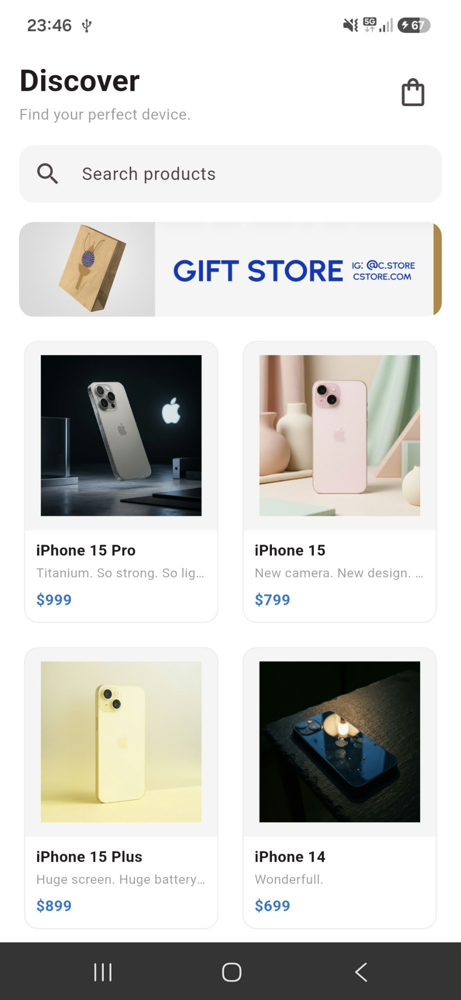
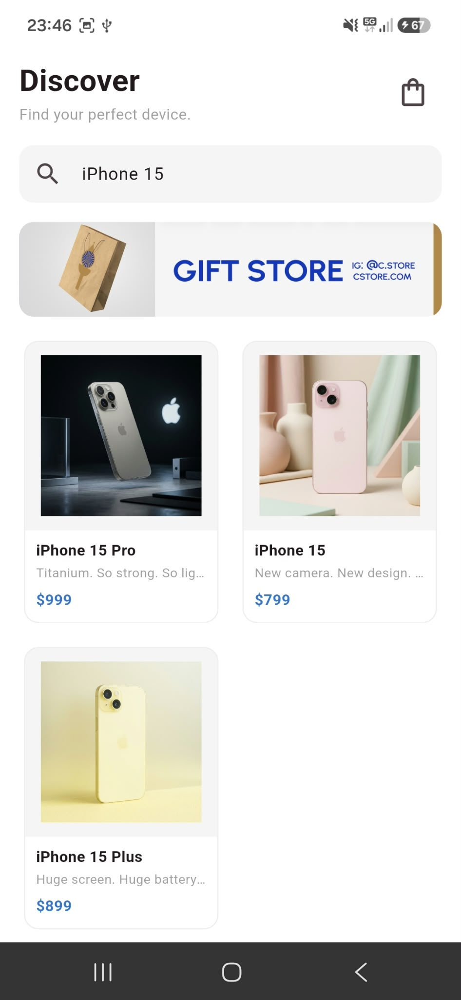
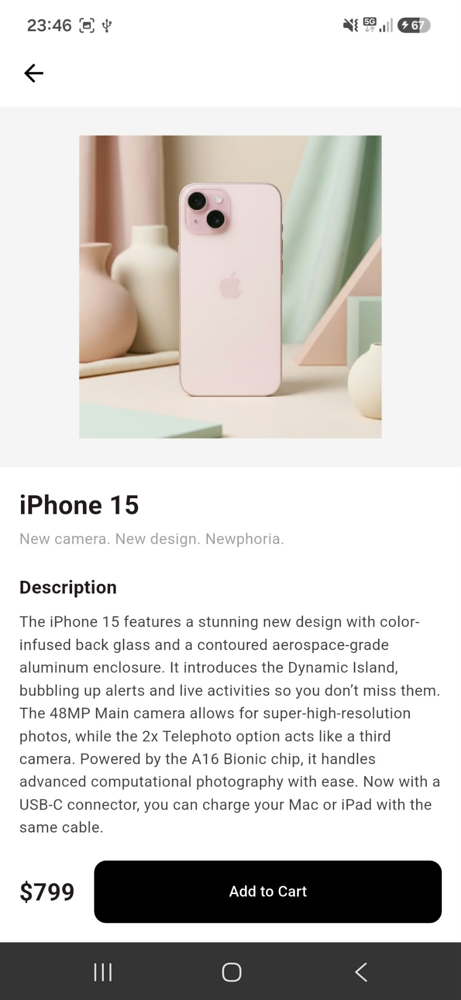
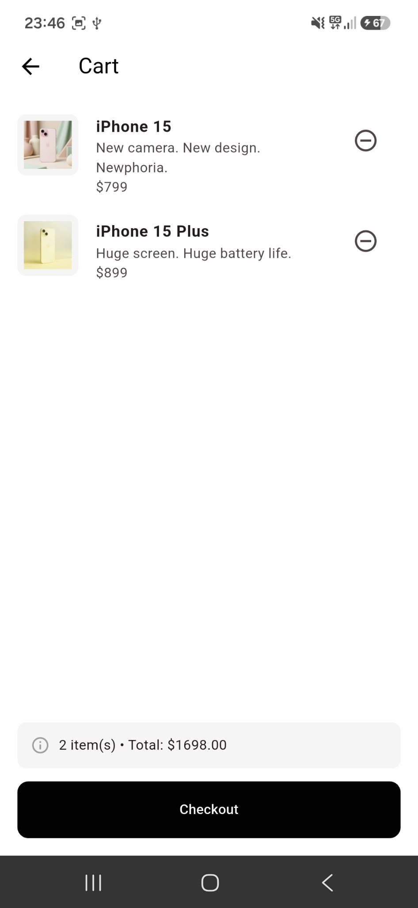
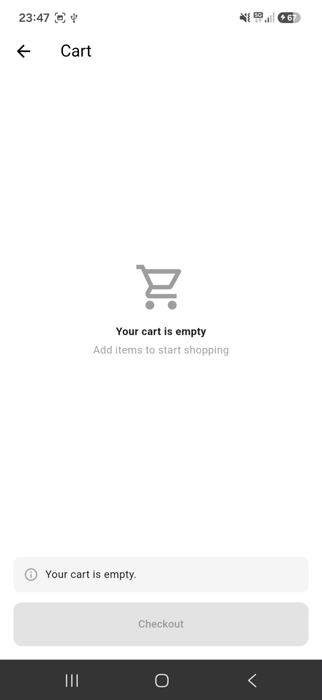

# 🛍️ Mini Katalog Uygulaması

Flutter ile geliştirilmiş basit bir ürün katalog uygulaması. Kullanıcılar ürünleri listeleyebilir, arama yapabilir, ürün detaylarını inceleyebilir ve ürünleri sepete ekleyebilir.

Bu proje, Flutter eğitimi kapsamında widget yapısı, sayfa geçişleri, veri modeli ve state yönetimi konularını uygulamalı olarak öğrenmek amacıyla geliştirilmiştir.

## ✨ Özellikler

- **Ürün listesi:** GridView ile 2 sütunlu ürün kartları
- **Arama:** Ürün adı ve sloganına göre anlık filtreleme
- **Ürün detayı:** Görsel, açıklama ve teknik özellikler
- **Sepet:** Ürün ekleme/çıkarma, toplam fiyat, sepet rozeti ve checkout simülasyonu
- **Sayfa geçişleri:** Named Routes ve Route Arguments ile veri taşıma
- **JSON veri:** Model sınıfı ile `fromJson` / `toJson` kullanımı

## 🛠️ Kullanılan Teknolojiler

| Araç | Sürüm |
|---|---|
| Flutter | 3.47.7 (stable) |
| Dart | 3.13.5 |
| Paketler | Sadece `material.dart`, ekstra paket yok |
| Test cihazı | Samsung Galaxy S24 FE (Android 16) |

## 📁 Proje Yapısı

```
lib/
├── main.dart                     # Uygulama girişi, tema ve rotalar
├── models/
│   └── product.dart              # Ürün modeli (fromJson / toJson)
├── data/
│   ├── product_repository.dart   # JSON'dan ürünleri okuma
│   └── cart.dart                 # Sepet simülasyonu
├── screens/
│   ├── home_screen.dart          # Ana sayfa: arama, banner, ürün grid'i
│   ├── product_detail_screen.dart
│   └── cart_screen.dart
└── widgets/
    ├── product_card.dart
    └── product_image.dart
assets/
├── data/products.json            # Ürün verileri
└── images/                       # Banner ve ürün görselleri
```

## 🚀 Çalıştırma Adımları

1. Flutter SDK'nın kurulu olduğundan emin olun:
```bash
   flutter doctor
```
2. Projeyi klonlayın:
```bash
   git clone https://github.com/KULLANICI_ADIN/mini-katalog.git
   cd mini-katalog
```
3. Bağımlılıkları yükleyin:
```bash
   flutter pub get
```
4. Android cihazı USB ile bağlayın (USB hata ayıklama açık olmalı) veya bir emulator başlatın, ardından:
```bash
   flutter run
```

## 📱 Ekran Görüntüleri

| Ana Sayfa | Arama | Ürün Detayı |
|:---:|:---:|:---:|
|  |  |  |

| Sepet | Boş Sepet |
|:---:|:---:|
|  |  |

## 📌 Veri Kaynağı

Ürün verileri ve görseller [wantapi.com](https://wantapi.com/products.php) adresinden alınmış ve uygulamaya asset olarak eklenmiştir. Bu veriler yalnızca eğitim ve demo amaçlıdır, gerçek bir e-ticaret altyapısını temsil etmez.

## 👩‍💻 Geliştirici

**Rana Tanrıverdi**